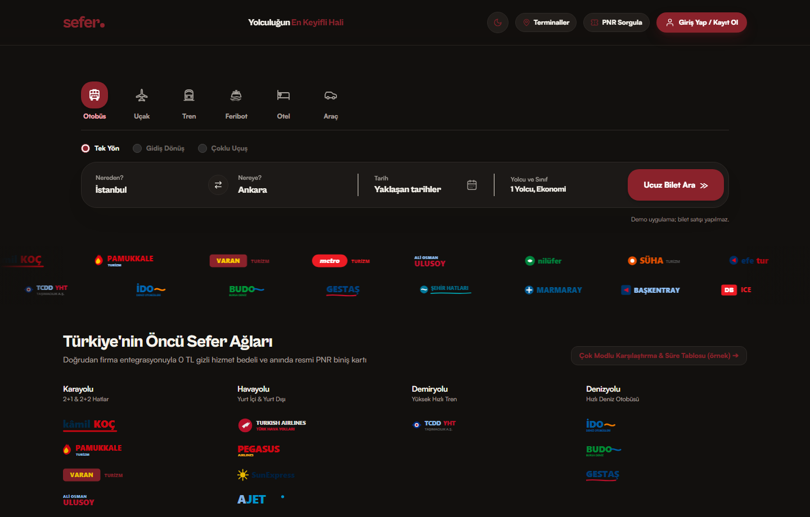

# Bileo



Bileo, Türkiye içi seyahat için uçak, otobüs, otel ve araç kiralama tekliflerini tek ekranda gösteren bir Vite + React sitesidir.
Veri, Turna.com landing sayfalarından (JSON-LD ve RSC katmanı) ve 2026-09-07'den beri başka Türk landing sayfalarından
(obilet.com, biletall.com, otelz.com, enuygun.com, flixbus.com.tr) okunur. Hiçbir ekranda uydurma veri yoktur: kaynak yayımlamıyorsa
alan null kalır, satır gösterilmez ya da "yayımlanmıyor" yazılır. Her teklif `source` alanı taşır ve arayüzde kaynak rozetiyle görünür.

## Yığın

- Vite 6, React 18, Tailwind 3.4, TypeScript (strict). Arayüz metni Türkçe, kod İngilizce.
- Sunucu tarafı iki Vercel fonksiyonu: `api/turna.ts` (Turna vekili) ve `api/search.ts` (diğer kaynaklar); ikisi de
  `src/server` altındaki aynı handler modüllerini kullanır. `vite dev` ve `vite preview` sırasında aynı modüller
  `src/server/turna/vitePlugin.ts` üzerinden `/api` altında servis edilir, yani geliştirmede ayrı bir sunucu gerekmez.
- Tasarım sistemi: krem zemin, bordeaux-700 vurgu, `src/components/icons` altındaki Bileo ikonları. `lucide-react` kullanılmaz.

## Dağıtım (Vercel)

`vercel.json`: `api/turna.ts` ve `api/search.ts` fonksiyonları için `maxDuration` 30 sn (yavaş hostların 26 sn bütçesi buna
sığar). Statik başlıklar: `/assets/*` bir yıl `immutable`; svg, png, jpg, webp, ico, woff2 ve woff dosyaları 30 gün
`stale-while-revalidate` ile. API yanıtlarının `Cache-Control` değerleri aşağıdaki "HTTP uçları" bölümünde.

## Çalıştırma

```bash
npm install
```

```bash
npm run dev
```

Geliştirme sunucusu varsayılan olarak 5173 portunda açılır (`npx vite --port 5173 --strictPort` ile sabitlenebilir).
Üretim derlemesi ve yerel ön izleme:

```bash
npm run build
```

```bash
npm run preview
```

## Test ve doğrulama

| Komut | Ne yapar |
|---|---|
| `npm test` | `src/tests/test_runner.ts`: 4 katmanlı özellik/sınır/etkileşim/senaryo testleri, challenger ve adversarial paketler, ikon sistemi, Turna ve çok kaynaklı arama testleri (`turna_scraper.test.ts`, `sources.test.ts`). Ağ yok, fixture tabanlı; 700'den fazla test (güncel sayı çalıştırıcı özetinde). |
| `npm run typecheck` | `tsc --noEmit` |
| `npm run build` | `tsc` + `vite build` |
| `npm run smoke:turna` | Canlı ağ üzerinden Turna ön ayarlarını dener (npm test'in parçası değildir; belgelenmiş ağ hata kodları SKIP sayılır). Bayraklar: `TURNA_SMOKE_PRESETS=0` yalnızca kontroller, `TURNA_SMOKE_CHECKS=2` veya `3` yalnızca Faz 2 (araç/otel) veya Faz 3 (geçmiş, delta, `?stats=1`) kontrolleri, `TURNA_SMOKE_ONLY=flight,bus` ve `TURNA_SMOKE_LIMIT=3` ön ayar süzme, `TURNA_SMOKE_BASE_URL=http://127.0.0.1:5173` çalışan sunucu üzerinden. Faz 3 tek bir Turna uçuş sayfası okur (robots + sayfa = 2 üst istek). Ayrıntı: `scripts/turna_smoke.ts` başlığı. |

Test çerçevesi kendi yazımımızdır (`src/tests/test_framework.ts`): `toEqual` JSON eşitliği, `toBe` kimlik eşitliği.

## HTTP uçları

- `GET|POST /api/turna`: Turna landing sayfası vekili. `kind` (`flight`, `bus`, `hotel`, `car`), `from`/`to` ya da `city`;
  `?stats=1` süreç içi sayaçları döndürür (istek, hata kodları, gecikme yüzdelikleri, kaynak bazlı `bySource` sayaçları).
  Başarılı yanıt: `items` (her öğede `source: "turna"`), `fetchedVia` (`direct` ya da `cache`), `scrapedAt`, `facts` (SSS
  metninden çıkarılan rota bilgileri), `stats` (min/ort/medyan/maks; otelde null), `history` (rota başına son 60 gerçek gözlem,
  `TURNA_HISTORY` ile), `delta` (önceki gözleme göre en düşük fiyat değişimi; ilk gözlemde null), `warnings`.
  Yanıt başlıkları: `X-Turna-Fetched-Via`, `X-Turna-Scraped-At`; `Cache-Control` başarıda `public, max-age=0, s-maxage=600,
  stale-while-revalidate=300`, `refresh=1` ile `private, no-store`, hatalarda `no-store`; engelde `Retry-After` saniye.
  `refresh=1` sunucu sayfa önbelleğini atlar, URL başına dakikada bir kabul edilir (aşımı `warnings` bildirir).
  Sözleşme: `TURNA_INTEGRATION.md` bölüm 2 ve `src/lib/turna/types.ts`.
- `GET /api/search?kind=bus|flight|hotel&from=..&to=..` veya `&city=..`; isteğe bağlı `&sources=obilet,enuygun` ve `&refresh=1`.
  Her kaynak için başarı ya da hata zarfı, `items`, `minPrice`, `fetchedVia`, `scrapedAt`, `warnings` ve `cheapestBySource` döner.
  `Cache-Control` en az bir kaynak başarılıysa `public, max-age=0, s-maxage=300, stale-while-revalidate=300`, aksi halde ve
  `refresh=1` ile `no-store`. `refresh=1` tüm kaynaklarda sayfa önbelleğini atlar (URL başına dakikada bir).
  Tipler `src/lib/sources/types.ts`, istemci doğrulayıcısı `src/lib/sources/client.ts`.

## Ortam değişkenleri

Şablon: `.env.example`. `vite.config.ts` bu dosyadaki `TURNA_*`, `DATABASE_URL`, `PG*` ve `DB_SSL` değerlerini `npm run dev` ve
`vite preview` için `process.env`'e taşır; Vercel'de aynı adlar proje ortamına yazılır. Hepsi isteğe bağlıdır.

| Değişken | Varsayılan | Anlamı |
|---|---|---|
| `TURNA_CACHE_TTL_MS` | 600000 | URL başına sayfa önbelleği (10 dk) |
| `TURNA_MIN_INTERVAL_MS` | 1200 | Aynı hosta ardışık istekler arası en az bekleme |
| `TURNA_BLOCK_COOLDOWN_MS` | 300000 | Akamai/bot engeli sonrası bekleme |
| `TURNA_REFRESH_MIN_MS` | 60000 | `refresh=1` ile zorla yenileme arası en az süre |
| `TURNA_NEG_CACHE_TTL_MS` | 60000 | Hatalı yanıtların olumsuz önbelleği |
| `TURNA_MAX_FETCHES_PER_MIN` | 20 | Dönen dakikalık istek bütçesi |
| `TURNA_RESPECT_ROBOTS` | 1 | robots.txt okuması (24 saat önbellek; 5 sn, yavaş hostlarda 12 sn) |
| `TURNA_HISTORY` | memory | Fiyat geçmişi: `memory` (rota başına son 60 gözlem, süreç içi), `off`, `pg` (`DATABASE_URL` ya da `PGHOST`/`PGPORT`/`PGUSER`/`PGPASSWORD`/`PGDATABASE`, TLS için `DB_SSL=true`) |
| `VITE_GOOGLE_CLIENT_ID` | boş | Google ile giriş (tarayıcıya açılır) |
| `JWT_SECRET` | | Sunucu tarafı JWT imza anahtarı. `NODE_ENV=production` iken zorunlu; yoksa sunucu token imzalamayı ve doğrulamayı reddeder. Geliştirmede kaynakta duran güvensiz dev anahtarı kullanılır. |

Not: `.env.example` içindeki `POSTGRES_*` adlarını kod okumaz; Postgres bağlantısı `DATABASE_URL` ya da `PG*` ile kurulur.
`docker-compose.yml` yerel bir Postgres 16 başlatır ve `src/server/db/schema.sql` şemasını yükler.

## Veri kaynakları ve dürüstlük kuralları

- Yalnızca tarihsiz landing sayfaları okunur; arama, tarihli, `api`, `json`, `ajax` uçlarına gidilmez. Her host için allowlist
  (`src/lib/sources/urls.ts`, Turna için `src/lib/turna/urls.ts`) ve robots.txt kontrolü vardır.
- Host bazlı zaman aşımı: varsayılan 10 sn deneme / 22 sn toplam; enuygun ve flixbus için 24 / 26 sn (`HOST_TIMEOUTS`).
- Koltuk doluluğu hiçbir kaynakta yayımlanmaz ve gösterilmez. Otel fiyatı yalnızca kaynağın yayımladığı yerde vardır (Turna, obilet,
  otelz ve enuygun otel sayfaları fiyat vermez). flixbus yalnızca rota bilgisi verir (başlangıç fiyatı, tipik süre, ilk/son kalkış);
  tarife yayımlamadığı için sefer satırı gösterilmez.
- Elle yazılmış örnek veriyle çalışan rehber modalları başlıkta "(örnek)" ve `SampleDataNotice` uyarısı taşır.
- Kaynak matrisi ve kararların gerekçesi: `KAYNAK_GENISLETME_PLANI.md` (bölüm 1 keşif, bölüm 5 uygulanan matris).
  Turna sözleşmesi ve arayüz kuralları: `TURNA_INTEGRATION.md`, `GELISTIRME_PLANI.md`.

## Dizin özeti

| Yol | İçerik |
|---|---|
| `src/server/turna/` | Turna fetch katmanı (`fetch.ts`, `robots.ts`), ayrıştırıcılar (`parse.ts`), HTTP (`http.ts`), sayaçlar (`metrics.ts`), geçmiş (`history.ts`) |
| `src/server/sources/` | Diğer kaynaklar: `microdata.ts`, `obilet.ts`, `otelz.ts`, `enuygun.ts`, `flixbus.ts`, `registry.ts`, `search.ts`, `http.ts` |
| `src/lib/turna/`, `src/lib/sources/` | Tarayıcıda da çalışan tipler, URL kuralları, istemci ve doğrulayıcılar |
| `src/components/results/` | Sonuç bileşenleri: `OtherSourcesPanel`, `SourceBadge`, `HotelResults`, `PriceHistoryStrip` |
| `src/tests/` | Test çalıştırıcı, çerçeve, fixture'lar: `fixtures/turna_fixtures.ts` (Turna JSON-LD ve RSC şekilleri) ve `fixtures/sources_fixtures.ts` (2026-09-07 kayıtlı sayfalardan kırpılmış 9 fixture: obilet otobüs/boş/uçak/otel, otelz otel, enuygun otobüs/uçak/otel, flixbus rota; testler ağ kullanmaz) |
| `api/` | Vercel fonksiyon sarmalayıcıları |
